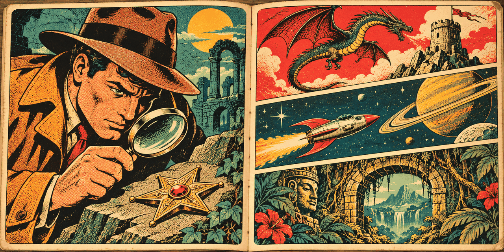

# 🎭 AI Story Creator

Pick a world, read the opening scene, and decide what your character does next. Each choice gives the storyteller a cue for the next page of your illustrated adventure.

**📑 Contents** · [Features](#features) · [Adventure genres](#genres) · [Narrative engine](#engine) · [Quick start](#start) · [Repository layout](#layout) · [Project status](#status) · [License](LICENSE)

<a id="features"></a>
## 🚀 Core features

| At the story table | What happens |
|---|---|
| Pick an adventure | The home page offers twelve starting themes and opens a new story with its first illustrated scene. [Theme selector](pages/HomePage.tsx) |
| Write a premise | Give your adventure a title and a description. Both become part of the prompt for the opening scene. [Custom story form](pages/CustomStoryPage.tsx) |
| Read it like a screenplay | Each scene has a heading, setting, character, parenthetical, line of dialogue and closing action. [Script renderer](components/StoryScript.tsx) |
| Choose what happens next | The storyteller is prompted for three choices. Selecting one records the decision and generates the next scene and illustration. [Story page](pages/StoryPage.tsx) · [Generation service](services/geminiService.ts) |
| Come back later | Completed turns are saved in the current browser. Pick a saved story under **Continue Your Adventures** to resume it. [Storage service](services/storageService.ts) · [Home page](pages/HomePage.tsx) |

<a id="genres"></a>
## 🌌 Adventure genres

Start with **Thrilling Mystery** to follow a clue, **Jungle Adventure** to hunt for treasure, or **Space Odyssey** to encounter an alien civilization. The other starting points are Epic Fantasy, Spine-Chilling Horror, Passionate Romance, Wild West, Martial Arts Master, Superhero Adventures, Cyber Detective, Shadow Operative and Psychological Terror. Each has its own premise in the [theme catalog](constants.ts).

<a id="engine"></a>
## 🎬 Inside a turn

The story page passes the title, theme, prior scene descriptions and actions, and the latest choice to Gemini. The service requests structured JSON from `gemini-2.5-flash`. One field describes the scene as a Western comic panel. A second request sends that prompt to `imagen-3.0-generate-002` for a widescreen JPEG. If illustration generation fails, the service supplies a placeholder image URL. [Prompt and image requests](services/geminiService.ts) · [Turn handling](pages/StoryPage.tsx)

**Tech stack.** React 19 and TypeScript render the pages, Vite 6 serves and builds them, and the Google GenAI SDK handles generation. The HTML shell loads Tailwind CSS from a CDN. [Package manifest](package.json) · [HTML shell](index.html)

<a id="start"></a>
## ⚡ Quick start

From the repository root, with Node.js and npm installed, run:

```powershell
npm install
```

Set `GEMINI_API_KEY` in a local `.env.local` file before starting Vite. Use a key with access to the configured generation models. Vite substitutes this value into client code, so anyone with access to the served app can inspect it. Keep a keyed build private. [Vite configuration](vite.config.ts)

```powershell
npm run dev
```

Open the local address Vite prints (configured port **3000**). To try the production bundle locally, run `npm run build` followed by `npm run preview`. The repository supplies these scripts and leaves hosting to the operator. [Available commands](package.json)

<a id="layout"></a>
## 🗂️ Repository layout

| Path | Responsibility |
|---|---|
| [App.tsx](App.tsx) | Initializes the browser-local user identifier and selects the active page. |
| [pages/](pages/) | Theme selection, custom premises and the current adventure. |
| [components/](components/) | Adventure cards, screenplay formatting, choice buttons and loading states. |
| [services/](services/) | Text and image requests plus browser-local story storage. |
| [types.ts](types.ts) | Scene, choice and story-history structures. |
| [Banner brief](assets/banner/BANNER_BRIEF.md) | Artwork prompts and the editable illustration. |

<a id="status"></a>
## 🧭 Project status

The reader shows the current scene. Earlier turns supply context for generation. A branch browser, replay controls, story export and cross-device sync are outside the current implementation. Clearing this site's browser storage removes its saved adventures. [Story reader](pages/StoryPage.tsx) · [Persistence](services/storageService.ts)

## 🤝 Contributing

For a new starting world, update the [theme catalog](constants.ts). For a change to scene structure, check the [generation schema](services/geminiService.ts), [types](types.ts) and [script renderer](components/StoryScript.tsx) together. Run `npm run build` before opening a pull request.

## 📄 License

Released under the [MIT License](LICENSE).
